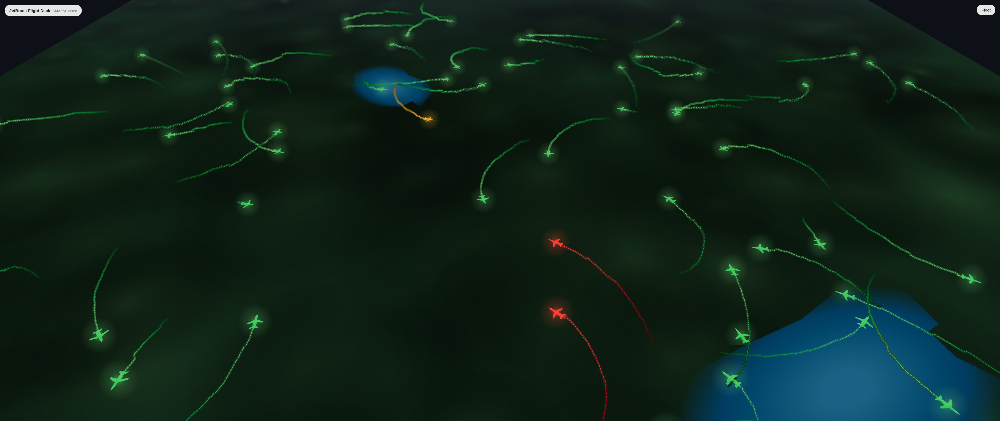

<p align="center">
  <!-- COVER IMAGE: wide banner, roughly 1600x500. Save as assets/cover.png -->
  
</p>

# JetBoost

An interactive web app that visualizes jet engine health and remaining useful life (RUL) predictions from a gradient boosting model trained on the NASA C-MAPSS dataset.

<p align="center">
  <!-- PREVIEW IMAGE: screenshot or GIF of the web app. Save as assets/preview.png -->
  
</p>

For the modeling work behind it, see the [blog post](https://YOUR-BLOG-URL/2026/10/01/jetboost). <!-- TODO -->

## Project structure

```
.
├── api/src/api/        # FastAPI inference service (inference.py)
├── web/src/            # Web app
│   └── scripts/        # prepare_fleet_data.py
├── ml/models/          # Trained models (e.g. FD004GBM)
└── data/
    ├── cleaned_data/   # Cleaned test sets used to build the fleet
    └── FE_data/        # Feature-engineered test sets used by the API
```

## Running the project

The API and the web app run separately, so use two terminals.

### 1. Start the API

```bash
cd api/src/api
fastapi dev inference.py
```

### 2. Start the web app

```bash
cd web/src
npm install   # first time only
npm run dev
```

## Changing the C-MAPSS subset

The project is set up for one subset at a time (FD001 to FD004). Switching subsets takes two changes, and both must point to the same subset.

### 1. Update the API

In `api/src/api/inference.py`, change `model_uri` to the model for the subset and `data_uri` to its test data. For example, for FD004:

```python
model_uri = "../../../ml/models/FD004GBM"
data_uri = "../../../data/FE_data/test_FD004"
```

### 2. Regenerate the fleet data

From `web/src/scripts`, run `prepare_fleet_data.py` with the cleaned test set for the new subset, the output path, and the number of engines to render:

```bash
cd web/src/scripts
python3 prepare_fleet_data.py ../../../data/cleaned_data/test_FD004 ../../public/data/fleet.json 100 --contiguous
```

| Argument                                | Description                                                 |
| --------------------------------------- | ----------------------------------------------------------- |
| `../../../data/cleaned_data/test_FD004` | Cleaned test set for the subset                             |
| `../../public/data/fleet.json`          | Output file the web app reads                               |
| `100`                                   | Number of engines to render                                 |
| `--contiguous`                          | Use engines 1 to N in order instead of a random sample of N |

Restart the API and the web app after switching.

## Dataset

[NASA C-MAPSS](https://www.nasa.gov/intelligent-systems-division/discovery-and-systems-health/pcoe/pcoe-data-set-repository/) is a synthetic run-to-failure turbofan dataset generated with MATLAB and Simulink. The dataset files are not included in this repository.

## License

Released under the [MIT License](LICENSE).
